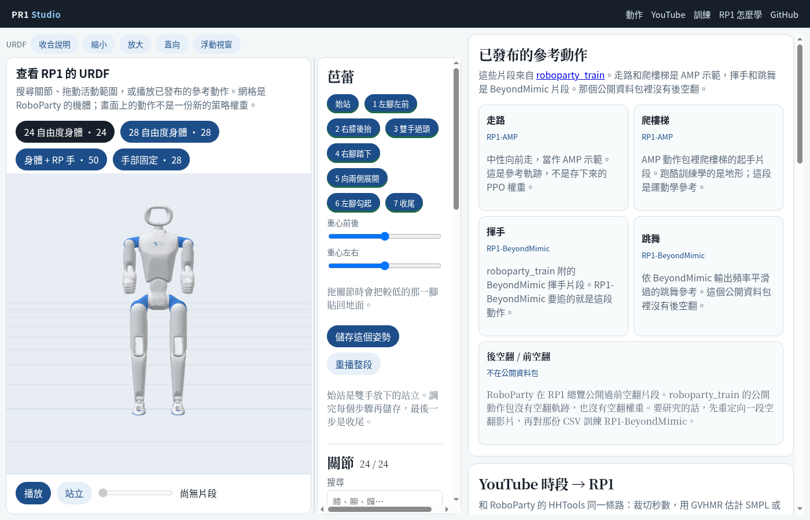
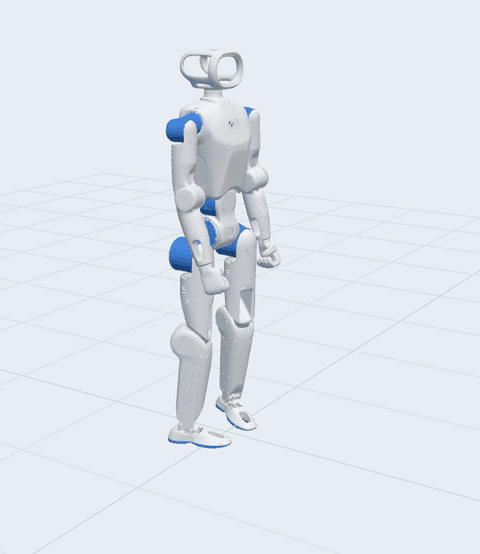

# PR1 Studio

本機上的 RoboParty RP1 工作室。預設是中文頁面：左邊固定看 URDF 和關節，右邊是參考動作、YouTube 重定向和 Isaac Lab 訓練。

學習路徑跟 [RP1](https://github.com/Roboparty/RP1) 和 [roboparty_train](https://github.com/Roboparty/roboparty_train) 一樣：裁 YouTube 時段、GVHMR 估計 SMPL 或 SMPL-X、[human-humanoid-tools](https://github.com/Roboparty/human-humanoid-tools) 重定向到 24 自由度身體，再用 Isaac Lab 3 和 RSL-RL 做 PPO。公開資料包裡有走路、爬樓梯、揮手、跳舞，沒有後空翻。前空翻是 RP1 總覽上的示範，不是這裡可以直接載入的策略。

## 網頁

橫向時機器人在左，已發布的參考動作和訓練選項在右。iPhone 打開會直接用直向：URDF 在上，說明先收起來，下面才是動作清單。直向可以拖中間的分隔線把機器人拉大。



## 訓好的芭蕾

下面這段是八步芭蕾 PPO 在 Isaac Lab 裡錄下來的約 10 秒，鏡頭從正面看 RoboParty 的 URDF。它是策略滾出來的結果，不是參考軌跡本身。



權重在 `checkpoints/rp1_ballet_balance/2026-11-08_05-02-50/model_11999.pt`。同一資料夾的 `track.npz` 是它追的參考，`params/agent.yaml` 是當時的 RSL-RL 設定。

```bash
PR1_MOTION_FILE=checkpoints/rp1_ballet_balance/2026-11-08_05-02-50/track.npz \
PR1_PLAY_OUTPUT=/tmp/ballet_motion.json \
~/projects/roboparty_train/.venv/bin/python scripts/play_pr1_job.py \
  --task=RP1-Ballet --num_envs=1 --viz=none \
  --checkpoint=checkpoints/rp1_ballet_balance/2026-11-08_05-02-50/model_11999.pt
```

## RoboParty 的 RP1 怎麼把芭蕾訓好

1. 八個姿勢存在工作室裡：始站、左腳左前、右膝後抬、雙手過頭、右腳踏下、向兩側展開、左腳勾起、收尾。存檔時較低的那一腳貼回地面，重心可以前後左右微調。
2. 重播把每個姿勢停住再混到下一個，寫成 HHTools 的關節 CSV，再依 roboparty_train 的方式轉成 50 Hz 的 `track.npz`。這次片段大約 5.37 秒、268 幀。
3. 任務是 `RP1-Ballet`，物理用 `newton_mjwarp`。動作是關節位置的小殘差，縮放 0.15，偏移跟當下的參考關節走。2048 個平行環境、每次 24 步、學習率 0.001、熵係數 0.005、clip 0.2、gamma 0.99、種子 42，一共 12000 次迭代。
4. 報酬先要求站得住：直立、朝向、自己腳下的支撐，再給「這一個姿勢像不像」和「整段走到哪裡」。一句話的進度報酬要乘上直立和支撐，所以摔倒時不會靠快轉時間拿分。

第一次 12000 次迭代的鐘卡在第一步。時間要同時滿足直立、朝向、關節誤差和支撐才會往前走；支撐又拿骨盆去比參考腳踝，幾乎過不了。片段報酬也太輕，策略學會不要倒，但 `phrase_progress` 停在約 0.20，後面七個姿勢都在檔案裡，卻沒有變成目標。

第二次改成八個關鍵幀。每個姿勢先站住 0.4 秒，或最多等 1.6 秒就強制進下一個，中間用 1 秒平滑過渡。支撐改看機器人自己的腳，哪一腳抬起才跟參考腳踝的高度。回合加長到 26 秒，讓八步都走得完。這樣即使某個姿勢一直站不穩，也不會整段停在始站。

跑完時，最後約 250 次迭代的片段進度大約 0.99、姿勢索引大約 6.9，報酬大約 475。直立、支撐、朝向都接近各自的權重上限，關節誤差還有大約 0.49。序列和平衡學到了；收尾的站姿還沒有乾淨地回到雙手放下的存檔。網站上點「芭蕾八步 PPO」會播這 12 秒的錄影。

## 這次試過的畫面

- 說明可以收合，URDF 跟著變高。
- 浮動視窗可以從標題列或上緣拖，固定回去會回到左欄，不再蓋住下面的表單。
- 橫向是現在的左右分割。直向把 URDF 放在上面、已發布的參考動作緊接在下面，高度可以拉到幾乎整頁。
- 播放和站立留在模型正下方，關節清單不會再擋到它們。
- 訓練中可以看迭代、剩餘時間和日誌。預覽是幾隻頭部分開的機器人和不同顏色的手腳未來軌跡，每幾十次迭代更新一張，不走即時串流。

## 執行

看 URDF、搜尋關節和任務 API 用 Python 3.11 以上即可。重定向和訓練用這台電腦上既有的環境。

```bash
bash scripts/start_studio.sh          # http://127.0.0.1:8890/
bash scripts/pinggy.sh                # 把 8890 轉成 HTTPS
```

頁面綁在 `0.0.0.0`。免費 Pinggy 大約 60 分鐘，終端機會印出 `https://….free.pinggy.net`。`scripts/start_studio.sh` 會帶一個工作執行緒。網站已經佔著鎖時，不要再跑 `scripts/worker.sh`。

| 動作 | 實際發生的事 |
| --- | --- |
| URDF 和關節滑桿 | 載入 RoboParty 的網格，角度停在 URDF 限制內，沒有物理。 |
| 走路、爬樓梯、揮手、跳舞 | 以公開的 AMP / BeyondMimic 參考在 24 自由度身體上播放。 |
| YouTube 起迄秒 | 排隊 yt-dlp → GVHMR → `hhtools retarget --robot rp1`。預設 SMPL-X，也可以選 SMPL。 |
| 訓練 | 寫下一筆工作；有 `~/projects/roboparty_train/.venv` 就啟動 Isaac Lab。剩餘時間用已完成的迭代來估。第一次迭代出現前，進度先空白。 |
| 練習長度 | 64 個環境、20 次迭代，讓日誌先出現。公開預算改回各任務設定，例如 `RP1-Flat` 是 9001 次。 |

SMPL 和 SMPL-X 的權重不在這個儲存庫。重定向讀 `~/.cache/hhtools/body_models`。第一次重定向會把 24 自由度 URDF 登記到 `~/.config/hhtools/robots/rp1`，並寫一個 T-pose 校正。要當成正式片段之前，先在 HHTools 裡把校正修過。

Isaac 環境不在時，工作會標成 blocked，頁面直接說明，不會假造進度。

## 目錄

- `assets/rp1_description`：URDF、MJCF 和 STL。見 `NOTICE.md`。
- `assets/motions`：降採樣後的參考動作。有 `~/projects/roboparty_train` 時，用 `python3 scripts/export_references.py` 重做。
- `checkpoints/rp1_ballet_balance/2026-11-08_05-02-50/`：八步芭蕾的最終權重和那次的參考片段。
- `public/`：工作室頁面。
- `docs/`：README 用的畫面和芭蕾 GIF。
- `.data/jobs/`：本機工作日誌，不進版控。

```bash
python3 -m unittest discover -s tests -v
```

## 來源

- [RoboParty](https://github.com/Roboparty) 和 [RP1 總覽](https://github.com/Roboparty/RP1)
- [RP1 description](https://github.com/Roboparty/rp1_description)
- [roboparty_train](https://github.com/Roboparty/roboparty_train)
- [human-humanoid-tools](https://github.com/Roboparty/human-humanoid-tools)
- 關節搜尋、YouTube 秒數和迭代剩餘時間的做法，沿用本機的 [q1_store_urdf](https://github.com/willnien10005914/q1_store_urdf)。
